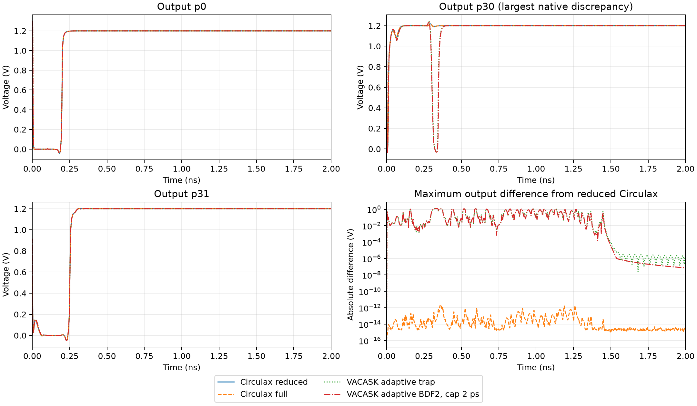
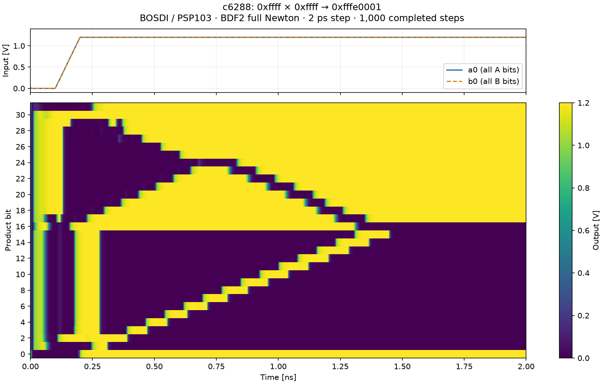

# c6288 multiplier stress test

Runs the original VACASK c6288 16×16 CMOS multiplier through Circulax and
BOSDI. Uses the upstream `benchmark/c6288/ngspice` transistor netlist and
PSP103 model cards, without a simplified MOS replacement. The circuit has
10,112 PSP103 instances, 32 driver resistors, and 34 voltage sources.
NMOS and PMOS instances share one BOSDI batch with per-instance parameters.
Sparse KLU symbolic analysis is reused across Newton solves.

<!-- BEGIN MEASURED COLLAPSE COMPARISON -->
## Measured collapse comparison, 2026-11-05

All three full and three reduced Circulax runs completed **2 ns at fixed 2 ps**
with BDF2/full Newton (1,000 steps), finite saved signals, valid final input and
output logic levels, and product **`0xfffe0001`**. All six native VACASK runs
also passed. These measurements use the same experimental BOSDI build for
both Circulax representations and identical OSDI binaries across simulators.

Each timing is a median over three sequential runs. Parentheses give min–max
and sample standard deviation, in seconds. **Circulax simulation time excludes
setup and JIT/warmup; VACASK time includes its whole process.**

| Configuration | Unknowns | Setup (s) | JIT/warmup (s) | Simulation or process time (s) | Accepted steps/points |
|---|---:|---:|---:|---:|---:|
| Circulax full, fixed BDF2 | 96,165 | 18.07 | 3.68 | 476.71 (476.26–480.72; σ=2.45) | 1,000 |
| Circulax reduced, fixed BDF2 | **25,381** | 19.18 | 1.26 | **58.84 (58.53–59.78; σ=0.65)** | 1,000 |
| VACASK upstream, adaptive trap | 25,380 | included | — | 69.92 (69.89–70.02; σ=0.07) | 1,022 |
| VACASK adaptive BDF2, maxstep=2 ps | 25,380 | included | — | 89.69 (89.51–89.86; σ=0.17) | 1,524 |

The reduced timed transient is **8.10× faster than the matched full
representation**. The unknown-count reduction is 3.79×, so a linear count-based
explanation is insufficient. Reduced setup ranges from 19.06
to 19.21 s; JIT/warmup ranges from 1.24
to 1.29 s. The two later reduced runs that also record
parent whole-process time took **83.21–84.34 s**, exceeding upstream VACASK's
whole-process time. Python import/startup and final waveform serialization are
outside Circulax's three individually measured phases. Thread budgets and
numerical tolerances also differ across simulators, as detailed below.

### Actual allocation and correctness

The configured PSP103 map is identical for all 10,112 instances, despite the
NMOS/PMOS parameter differences:

```text
raw slot:       0 1 2 3 4 5 6 7 8 9 10 11 12
representative: 0 1 2 3 4 1 2 0 3 3  3  3 12
```

Four terminals plus **both genuine noise auxiliaries** survive. Seven slots per
device are removed, eliminating **70,784 unknowns**. The remaining 20,224 OSDI
internals plus 5,157 other circuit variables give **25,381**, exactly one more
than VACASK because Circulax retains an explicit ground slot. The maps come
from setup at **300.15 K**, transient analysis, the actual per-instance arrays,
and the registration's simulator settings; the later full/reduced records also
have identical parameter-array SHA-256 hashes.

The maximum difference between full/reduced saved c6288 outputs is
**2.403×10⁻¹² V**, RMS **4.094×10⁻¹⁴ V**. Repeated waveforms are deterministic.
DC, transient, and AC projection/solve tests cover mixed collapse patterns,
ground/inactive slots, terminal unions, repeated indices, charge history,
parameter updates, and analysis/settings registrations. The final expanded
Circulax test suite passed **354 tests with no skips**. The separate released
BOSDI 0.1.8 compatibility run passed **22 tests**, and a real c6288 preparation
with that package fell back to **96,165 unknowns** with no topology metadata.
BOSDI's own native tests passed **53**, with **30 optional compiler cases
skipped**; its independent OSDI 0.5 header fixture was exercised. Circulax's
Library loader remains OSDI **0.4**.

Compilation logs show exactly **one `circuit_diffeqsolve` compilation per
Circulax process**, across warmup and timed calls, for all six c6288 and all
18 ring runs. The standalone short-call JIT audit is retained as well.

### Cross-simulator waveforms and limitations

Identical final digital output does **not** establish analog waveform agreement.
Relative to reduced Circulax, native adaptive trap has **1.2305 V peak / 75.68 mV
RMS** output error; capped adaptive BDF2 has **1.2344 V peak / 75.86 mV RMS**.
The differences include a native `p30` glitch absent from the fixed-step
Circulax trace. Final output differences are much smaller: **2.10 µV** and
**73.34 nV**, respectively. Native signals are linearly interpolated onto the
1,001 Circulax saved times for these comparisons. The complete cause of the
switching/glitch discrepancy has not been isolated; changing tolerances,
refining the fixed step, and auditing startup would be separate accuracy work.
The original dialect-normalized gate topology and ordered subcircuit ports
match across all **2,437 source rows**; this does not independently validate
every step of either simulator's elaboration.



### Ring regression measurements

The existing 1 µs / fixed 50 ps, trapezoidal frozen-Newton OSDI benchmark ran at
3, 9, and 15 stages, three repetitions per representation. Every recorded run
completed with finite states and oscillation. These times exclude DC and JIT.

| Stages | Unknowns full → reduced | Full median (range), s | Reduced median (range), s | Frequency full → reduced, MHz |
|---|---:|---:|---:|---:|
| 3 | 62 → 20 | 2.333 (2.307–2.363) | 1.907 (1.905–1.920) | 913.492432475 → 913.492434586 |
| 9 | 176 → 50 | 6.082 (6.068–6.100) | 4.977 (4.662–5.015) | 288.882978151 → 288.882978143 |
| 15 | 290 → 80 | 9.276 (9.222–9.393) | 7.514 (7.470–7.613) | 173.789968910 → 173.789776432 |

The largest frequency difference is **1.11 ppm** at 15 stages. Its original
homotopy starts differ by **44.7 mV**, and its unaligned transient difference
is **0.177 V peak / 39.7 mV RMS**; the 3-/9-stage maximum differences are
1.19×10⁻⁸ / 4.59×10⁻⁸ V. The startup audit below distinguishes this initialization
limitation from the reduced assembly. Performance improved at all three sizes;
these measurements do not establish pointwise equivalence of separately
initialized 15-stage trajectories.

### 15-stage startup failure and controlled comparison

The original source/gmin homotopy did **not** reach a DC operating point at
15 stages. Its output starts at 1.264939 V (full) versus
1.220240 V (reduced), and the maximum absolute non-ground
mixed residuals are 0.0029608 and
0.0047198. A separate checked Newton
refinement with 500 iterations and tighter tolerances also failed in both
representations. The original ring harness only checked finiteness and a loose
magnitude bound; its transient `status=ok` does **not** certify DC convergence.
The harness now records the initial output and DC residual explicitly. The
public homotopy solver's discarded convergence status is an existing limitation
left unchanged here; use a checked solve when a true operating point is required.

A controlled additional full/reduced pair uses **the same raw-consistent UIC**:
all ring nodes at 0.6 V, VDD at 1.2 V, zero source-current/noise auxiliaries,
with full raw aliases expanded using each handle's actual mapping. Both
complete the existing 1 µs / 50 ps trapezoidal run with finite states. Output
error is **1.13e-08 V maximum / 1.61e-09 V
RMS**, and frequencies are 173.780382506 /
173.780382505 MHz. Thus the large default-start phase difference
is not evidence of lost internal dynamics or a reduced stamp mismatch.
See [ring-startup-audit.json](ring-startup-audit.json) and reproduce with
`.venv/bin/python -m benchmarks.c6288.audit_ring_startup`.

### Remaining cost and kernel diagnostic

Stored unique COO coordinates fall from **1,453,457 to 216,753**. VACASK reports
158,904 initial structural nonzeros. Native BOSDI buffers stay **(10,112, 13)**
for voltages/F/Q and **(10,112, 169)** for G/C in both representations.

The separate zero-iterate diagnostic uses three repetitions of ten synchronized
calls, after each kernel's own JIT warmup. Median milliseconds per call:

| Kernel | Full | Reduced |
|---|---:|---:|
| Raw PSP103 BOSDI evaluation | 3.82 | 4.49 |
| System assembly including evaluation | 5.93 | 11.15 |
| COO coalescing + numeric KLU factor/solve | 137.39 | 23.85 |

All diagnostic outputs were finite. Raw evaluation did not become faster;
standalone assembly became slower, while the numeric sparse path improved
substantially. Initial diagnostic batches are retained separately to show
short-kernel variability. These are **zero-bias kernel measurements, not a
whole-transient decomposition**: Newton iteration counts, matrix values, and
loop-invariant hoisting also affect runtime. The full-Newton Circulax path calls
`solve_with_symbol`, while native logs report one factorization followed by
3,502 (trap) or 4,638 (BDF2) refactorizations. That API/algorithm difference,
remaining excess COO structure, dense device-stamp traffic, and approximately
19 s of setup deserve separate profiling; unknown count alone does not explain
all differences. Native timings are dominated by eval/load (about 63.6 s trap,
81.4 s BDF2 in the first runs), and its continuous-bypass behavior also differs.

Machine-readable details are in [integration-summary.json](integration-summary.json).
Commands, revisions, source/runtime/model hashes, logs, `.npz` waveforms,
[tests](integration-tests-complete.log), [released compatibility](released-bosdi-tests.log),
and [kernel profiles](profile-reduced.json) are retained alongside this README.
There are no outstanding c6288 transient failures. The original failed frozen-
Newton warmup remains historical context below; no new result is presented as
an exhaustive multiplier functional test.
<!-- END MEASURED COLLAPSE COMPARISON -->

```sh
export VACASK_REPO=/path/to/VACASK
pixi run python benchmarks/run.py run c6288
# Or use an existing Circulax/BOSDI environment:
python benchmarks/c6288/run.py --vacask-root /path/to/VACASK
```

The VACASK source is available at
<https://codeberg.org/arpadbuermen/VACASK/src/branch/main/benchmark/c6288>.
External sources stay in that checkout; result files record their hashes.
Use a checkout containing `ngspice/{runme.sim,models.inc,multiplier.inc}` and
`devices/{psp103v4/psp103.va,spice/resistor.va}`.

The default is a 2 ns transient at a fixed 2 ps step, matching the upstream
stop/step and `uic` zero initialization. All 32 inputs rise from 0 to 1.2 V
between 0.1 and 0.2 ns. The omitted pulse fall/width/period are made explicit;
no falling edge occurs within the run. The original simulator control block
is replaced by the Circulax harness. BDF2 with full Newton is the default;
`--solver trap` matches the ring benchmark's integration method, and
`--newton frozen` factors once per step. `--solver euler` selects backward
Euler. These fixed-step methods are not identical to VACASK's adaptive method.

```sh
python benchmarks/c6288/run.py --prepare-only
python benchmarks/c6288/run.py --solver trap --output trap.json
python benchmarks/c6288/run.py --step 1e-12 --output finer.json
python benchmarks/c6288/run.py --timeout 1200 --max-newton 200
```

Setup and JIT warmup are reported separately from the timed transient.
Warmup uses the same save shapes and step budget as the timed call. Only
64 input/output signals are saved, avoiding a complete internal-node history.
A child process bounds the run (600 seconds by default). JSON progress,
CSV summary, and logs survive a solver error, timeout, or worker crash.
Timed attempts also write compressed waveforms (`.npz`).

Success requires the solver to complete with finite samples, the final
inputs to be valid high levels, and the final 32-bit product to equal
`0xffff × 0xffff = 0xfffe0001`, with every bit below 0.2 VDD or above
0.8 VDD as appropriate. `logic_mismatch` distinguishes a completed transient
from a correct digital result. A shorter `--stop` may fail this check because
the multiplier has not settled. This is one stress vector, not exhaustive
functional verification or a cross-simulator accuracy claim. Use a smaller
step and reference waveforms before drawing accuracy conclusions.

## OpenVAF / OSDI compatibility

The benchmark checks exported ABI symbols before loading BOSDI. Circulax's
`Library` path currently requires OSDI **0.4**. BOSDI's experimental branch
accepts 0.5 through its explicit `version` argument, but Circulax's metadata
loader and descriptor provisioning still use 0.4; installing that branch alone
does not make this benchmark accept 0.5.

Use `--compiler /path/to/compatible/openvaf-r`, or supply **both**
`--psp-osdi /path/to/psp103v4.osdi` and
`--resistor-osdi /path/to/resistor.osdi` (module `sp_resistor`). There is no
need to replace the system compiler. A compiler's version string does not
identify the emitted OSDI ABI; the result JSON records the actual ABI.

## Initial measurements before collapse integration, 2026-11-05

During the initial experiment, the compiler on PATH reported `OpenVAF-reloaded 20260616-4-g5ed9e63a` and
emitted **0.4** for both models. The installed BOSDI was **0.1.8**, JAX
**0.7.2**, CPU. The experimental BOSDI checkout was not installed into this
environment.

The compiled system contains **96,165 unknowns**. The initial frozen-Newton
BDF2 attempt failed during the two-step warmup with nonlinear divergence.
Topology setup took 16.46 s after fixing repeated instance-table copying in
node mapping; JIT plus failed warmup took 1.63 s. This is a convergence
failure, not an ABI loading failure. Full Newton then completed the complete run successfully:

| Configuration | Setup (s) | JIT/warmup (s) | Timed transient (s) | Steps | Result |
|---|---:|---:|---:|---:|---|
| BDF2, full Newton, 2 ps | 15.52 | 3.61 | 455.45 | 1,000 | `0xfffe0001`, valid logic on all 32 bits |

All 64 saved input/output signals were finite. Inputs reached valid high
levels, and the initial product was zero. This confirms the supplied stress
vector runs on this configuration; batching speedup and cross-simulator
accuracy have not been measured. Timings were collected on a busy workstation
and should be treated as an initial measurement. Results are in
[`results.json`](results.json) and [`results.csv`](results.csv); the failed
frozen-Newton attempt is retained separately.



## Noise-related diagnostics

The older ring benchmark documents Newton stagnation involving PSP103's
`v_NOI` / `i_NOII` auxiliary variables on its **direct VA-to-JAX** path
(`benchmarks/ring/bench_circulax.py`). That observation does not establish
an equivalent bug in BOSDI's compiled OSDI path. PSP103's source includes
auxiliary noise branches with deterministic conductance/charge terms;
those still need consistent device stamps in a transient calculation.

BOSDI's current evaluator loads deterministic residuals and Jacobians; it
does not expose the OSDI `load_noise` callback as a noise-analysis API.
This benchmark does not request stochastic or small-signal noise analysis.
The frozen-Newton startup failure has not been isolated to a noise equation;
full Newton passed the same startup. Do not label it a noise bug without
checking the actual residual/Jacobian at the failed iterate.

## Configured node-collapse integration

The compiler now queries `handle.topology` on the **same configured native
batch used for evaluation**. Per-instance parameters, registration temperature,
analysis, numeric simulator settings, and the model binary determine this
snapshot. External terminal shorts are unioned before allocation across all
groups. Only surviving internal representatives receive global unknowns;
raw aliases gather from their representative and ground/inactive slots gather
literal zero. Native voltage/F/Q buffers remain `(N, raw_num_nodes)` and G/C
remain `(N, raw_num_nodes**2)`.

Assembly selects physical equation rows **before** scatter. Equality rows are
removed instead of relying on floating-point cancellation of their `+1/-1`
Jacobian entries. Ground rows and columns are excluded, while repeated global
COO coordinates are summed. The same selection covers residual-only line
searches, transient charge history, DC, AC, HB, and adjoint capacitance. Genuine
reactive nodes and active noise auxiliaries remain allocated. The integration
also removes a duplicate native-capacitance addition in transient adjoints.

`compile_netlist(..., osdi_reduction=False)`, `compile_circuit(...)`, and
`ResolvedCircuit.compile(...)` expose the full representation for comparisons
and traced parameter workflows. When BOSDI lacks topology metadata, compilation
automatically uses the full representation. A batch with an identity mapping
also retains its existing full-group behavior when its candidates cannot join
external nets; otherwise the topology-update guard stays active even before the
first collapse. The Library metadata loader
continues to require **OSDI 0.4**; this integration adds no OSDI 0.5 loader support.

Reduced groups accept eager `with_params` updates only after configuring a new
handle and checking its actual mapping. Topology changes are rejected with a
request to recompile; traced updates require full allocation. Direct Equinox
parameter swaps cannot silently leave a stale handle: assembly checks the
parameter snapshot. Analysis variants reject changed allocation or mappings;
`set_simparams` builds a new circuit, including allocation and factorisation.
Solutions and transient histories are not automatically transferred across a
topology change. Reduced Schur elimination is explicitly rejected. Models whose collapse-candidate
graph can join external terminals (or a terminal to ground) require reduced
allocation; the full opt-out rejects them, including before traced updates could
activate such a short. This conservative full-mode guard uses candidates only
to reject unsupported configurations; allocation always uses the actual native
mapping. Full internal allocation remains valid for models whose candidate
classes cannot join distinct external nets.

### Reproduction and artifacts

The installed runtime was rebuilt from the dirty experimental checkout,
including its uncommitted implementation. `integration-provenance.json` records
repository revisions, working-tree state, dependency versions, CPU and affinity.
`bosdi-integration-input.patch` preserves tracked BOSDI changes against its
recorded revision. Runtime Python/native module paths and SHA-256 hashes are
recorded in the newer measurement JSON files. Model and netlist hashes accompany
every c6288 run. No upstream checkout files were edited by this integration.

The environment build used a copy under `/tmp/circulax-bosdi-experimental`,
excluding Git metadata and build products:

```sh
SETUPTOOLS_SCM_PRETEND_VERSION_FOR_BOSDI=0.1.9.dev0 \
  uv pip install --python .venv/bin/python --no-deps /tmp/circulax-bosdi-experimental

# Use a fresh output directory to rerun rather than resume earlier measurements.
.venv/bin/python benchmarks/c6288/repeat_integration.py \
  --vacask-root /home/cdaunt/code/vacask/VACASK \
  --binary /home/cdaunt/code/vacask/VACASK/build/simulator/vacask \
  --library-dir /home/cdaunt/code/vacask/VACASK/.pixi/envs/default/lib \
  --repeats 3 --resume
.venv/bin/python benchmarks/c6288/summarize_integration.py
```

`commands.jsonl` records the sequential subprocess invocations and relevant
thread/JAX environment settings. All c6288 Circulax runs use dynamic JAX scalar
times and one shared save callback. `JAX_LOG_COMPILES=1` logs are retained, and
the summary counts `circuit_diffeqsolve` compilations across warmup and the timed
call. Setup, JIT/warmup, and simulation times are reported separately. Ring
warmup/timed calls also pass dynamic scalar times with identical save shapes.
The ring benchmark keeps its existing 1 µs / 50 ps trapezoidal frozen-Newton
configuration; it is a regression check, separate from c6288's BDF2/full Newton.

VACASK uses the exact OSDI binary paths/hashes from the Circulax run, one
simulator CPU and one BLAS CPU. Its upstream configuration is adaptive
trapezoidal integration. `bdf2-capped` uses adaptive BDF2 with `maxstep=2 ps`;
**a step cap does not make it fixed stepping**. Circulax uses a fixed 2 ps
step and Newton update tolerances `rtol=1e-6`, `atol=1e-8`. VACASK retains the
upstream `nr_convtol=1`, `nr_bypass=0`, `nr_contbypass=1`, `tran_lteratio=1.5`
and its source defaults: `reltol=1e-3`, `vntol=1e-6 V`, `abstol=1e-12 A`,
`chgtol=1e-15 C`, `fluxtol=1e-14 Wb`. These are different convergence criteria;
Circulax has no adaptive LTE controller in this experiment. VACASK times cover
the whole process, while Circulax's simulation column excludes setup and JIT.

BOSDI uses its default Rayon dispatch with `RAYON_NUM_THREADS` unset and 24
available CPUs on this host; VACASK is explicitly configured for one simulator
CPU. Full/reduced measurements have the same thread policy, but cross-simulator
ratios are **not comparisons at an equal thread budget**. Other workstation
activity is uncontrolled, so the repeated measurements include scheduling
variability. The ring worker compiles the repository's missing OSDI fixtures
with `scripts/compile_osdi.py` before its first measurement; ring results record
the model binary and fixture hashes, and all variants use that same binary.

### Verification scope

The integration tests compile small OSDI 0.4 models with a mixed collapsed /
uncollapsed series-RC batch, active / inactive branch-current slots, and
terminal-to-terminal / terminal-to-ground shorts. They compare reduced F/Q/G/C
with the physical projection of the full constrained DAE, independently solve
DC, backward-Euler history steps, and complex AC systems, and finite-difference
the gathered/scattered residual. A `1e-24` physical stamp next to an equality
constraint checks that physical-row selection avoids cancellation loss.
Public transient and AC paths, transient charge history, and dense / sparse
adjoint capacitance share these checks. Parameter finite differences must also
configure and check their perturbed topology; a perturbation crossing a collapse
boundary raises rather than reporting a derivative for a stale layout.

Temperature, simulator-setting, and analysis variants are configured separately
and checked against native maps. One fixture deliberately uses runtime queries
in its conditional equations: OpenVAF retains those nodes, and the test confirms
that Circulax follows the native map instead of inferring a collapse. A factory
returning a different actual topology is rejected before solving. Topology
updates are tested in eager mode, inside JIT, and via direct Equinox swaps.

The native BOSDI test log separately exercises its 0.4 collapse implementation
and the independent 0.5 C-header fixture. Tests requiring an external 0.5
OpenVAF compiler skip when `BOSDI_OPENVAF_05` is unset. This verifies BOSDI's
experimental support without claiming Circulax's Library accepts that ABI.

### Additional reproducibility commands

The experimental source copy used for the environment build can be recreated
from the recorded checkout and its preserved dirty patch:

```sh
.venv/bin/python - <<'PYBUILD'
import shutil
shutil.copytree(
    "/home/cdaunt/code/bosdi", "/tmp/circulax-bosdi-experimental",
    ignore=shutil.ignore_patterns(".git", ".pixi", ".venv", "target", "build", "dist", "tests"),
    dirs_exist_ok=True,
)
PYBUILD
# Install the experimental copy with the explicit version command above.
uv pip install --python .venv/bin/python --target /tmp/circulax-bosdi-released --no-deps bosdi==0.1.8

# Run only after the sequential simulator sweep exits.
bash benchmarks/c6288/final_validation.sh
.venv/bin/python -m benchmarks.c6288.audit_ring_startup
.venv/bin/python benchmarks/c6288/audit_source_topology.py \
  --vacask-root /home/cdaunt/code/vacask/VACASK
.venv/bin/python benchmarks/c6288/summarize_integration.py
.venv/bin/python benchmarks/c6288/write_integration_report.py
```

`integration-provenance.json` also records the Rust/C++/uv toolchain and final
source hashes. The generated patch includes the tracked Circulax changes; new
source files and benchmark scripts are saved directly in this working tree.
The initial diagnostic timing batches and earlier test logs are retained,
including the strict XPASS results that justified removing three obsolete
adjoint expected-failure markers. The final test log is the authoritative run.
