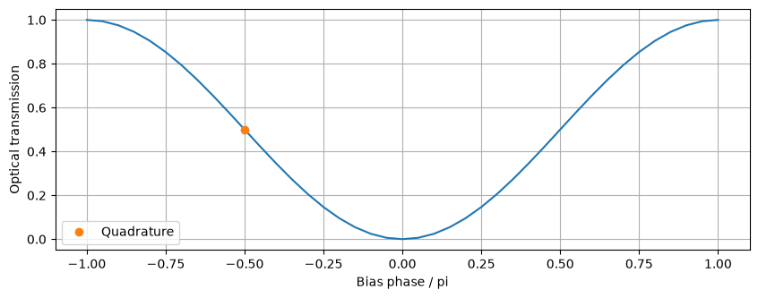
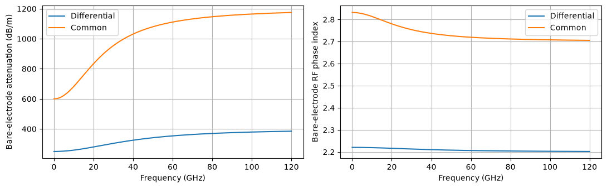
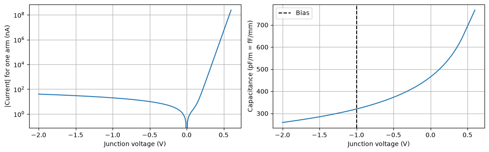
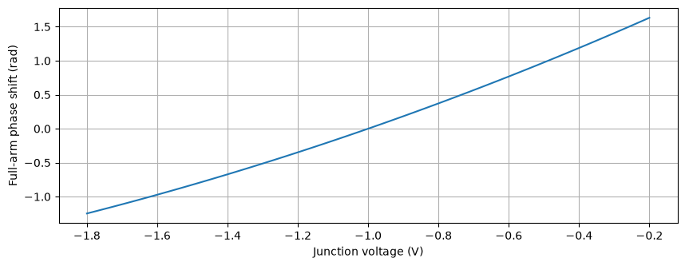
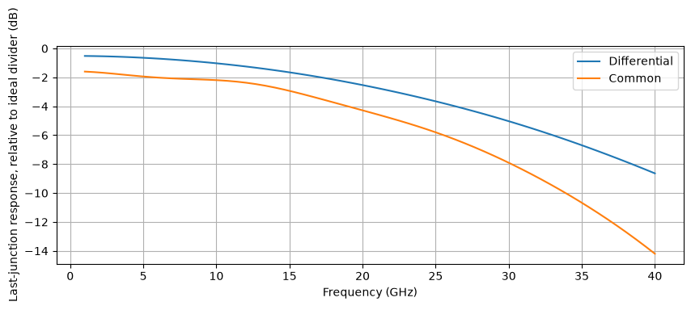
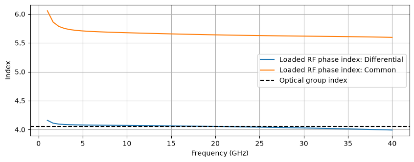
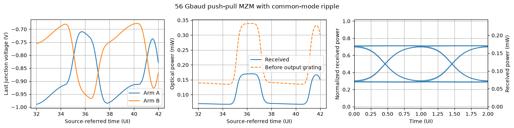
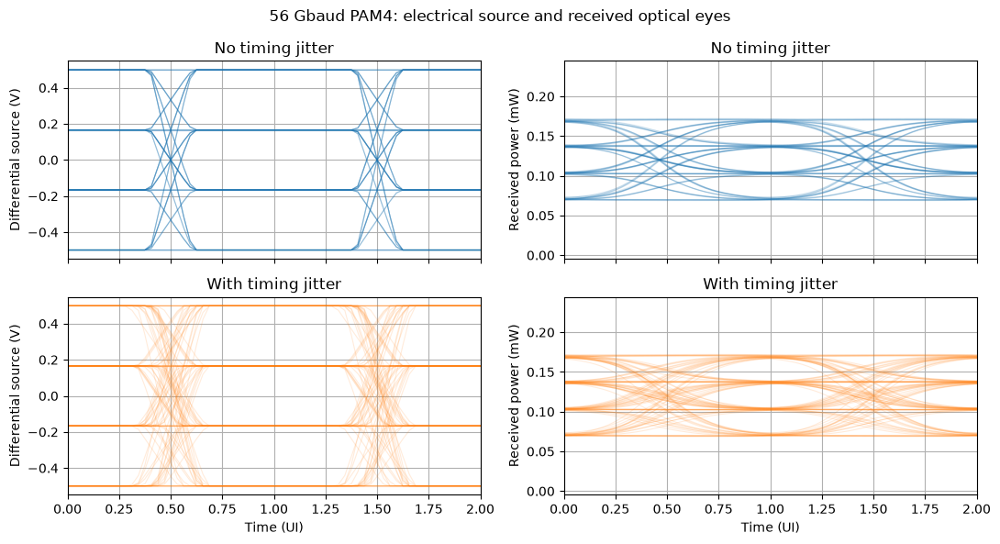

# Push-pull traveling-wave MZM model

A Mach–Zehnder modulator (MZM) with differential-mode and common-mode electrodes is constructed and used to simulate a **56 Gbaud optical link** with input and output grating couplers. The modulator is first driven with a binary signal; four-level pulse-amplitude modulation (PAM4) eye diagrams are then compared with and without transmitter timing jitter.

Each arm is divided into PN junction phase-shifter sections. Each section includes junction capacitance, a quadratic relationship between voltage and optical phase, optical loss, and propagation delay. The parameters are illustrative and would be replaced by extracted device data when a specific design is modeled.

The cells below define the components, assemble the circuit, and generate the drive waveforms. `mode_transmission_line` builds the electrode models, and `DifferentialAdapter` connects the modal voltages and currents to the physical junctions. A compact two-port line model is demonstrated in [the reduced RLGC line example](rlgc_transmission_line.md).


```python
import copy
import time

import jax
import jax.numpy as jnp
import matplotlib.pyplot as plt
import numpy as np

from circulax import compile_circuit
from circulax.components import DifferentialAdapter, mode_transmission_line, phase_shifter_factory, pn_diode
from circulax.components.base_component import component
from circulax.components.electronic import (
    WAVE_DC,
    WAVE_PWL,
    WAVE_SIN,
    Resistor,
    WaveformVoltageSource,
)
from circulax.components.photonic import DirectionalCoupler, Grating, OpticalSource

jax.config.update("jax_enable_x64", True)
plt.rcParams.update({"figure.figsize": (10, 3.5), "axes.grid": True})
c0 = 299_792_458.0
length_m, n_sections = 2e-3, 6
dz = length_m / n_sections
n_opt, wavelength_um, optical_loss_db_cm = 4.05, 1.55, 1.0
rj_product, cj_per_m = 4.7e-3, 320e-12  # ohm m, F/m
v_bias, phase_a1, phase_a2 = -1.0, 1.2, 0.15  # V, rad/(V mm), rad/(V² mm)
source_r = load_r = 30.0  # per conductor, ohms
laser_power, grating_loss_db = 1e-3, 3.0  # W, dB per grating
quadrature_phase = -np.pi / 2
print(f"{n_sections} sections: {dz * 1e6:.1f} um, Rj={rj_product / dz:.2f} ohm, Cj={cj_per_m * dz * 1e15:.1f} fF")
```

    WARNING:2026-10-31 17:47:23,713:jax._src.xla_bridge:864: An NVIDIA GPU may be present on this machine, but a CUDA-enabled jaxlib is not installed. Falling back to cpu.


    6 sections: 333.3 um, Rj=14.10 ohm, Cj=106.7 fF


## 1. Optical MZM

The optical circuit is constructed first. Two 50/50 couplers split the input light between two arms and recombine it at the output. The unused ports are terminated with matched 1 Ω optical-envelope loads. A separate phase shifter sets the relative phase between the arms:

```text
                  ┌──── arm A ───────┐
input ─ splitter                     combiner ─ output
                  └──── arm B ─ bias ┘
```

A constant phase is initially applied in each arm. For this wiring, the power transmission is $P_\mathrm{out}/P_\mathrm{in}=[1-\cos(\theta)]/2$, where $\theta$ is the relative arm phase. The sweep below verifies that $\theta=-\pi/2$ gives quadrature bias: half transmission and maximum modulation slope.


```python
@component(ports=("p1", "p2"), states=("a1", "a2"), holomorphic=True)
def PhaseBias(signals, phase=0.0):  # noqa: N802
    """Matched, reciprocal phase-only optical element; field impedance is 1 ohm."""
    transmission = jnp.exp(1j * phase)
    b1, b2 = transmission * signals.a2, transmission * signals.a1
    return {
        "p1": signals.a1 - b1,
        "p2": signals.a2 - b2,
        "a1": signals.p1 - signals.a1 - b1,
        "a2": signals.p2 - signals.a2 - b2,
    }, {}


def optical_netlist(arm_a, arm_b):
    return {
        "instances": {
            "GND": {"component": "ground"},
            "SPLIT": {"component": "coupler", "settings": {"coupling": 0.5}},
            "COMBINE": {"component": "coupler", "settings": {"coupling": 0.5}},
            "BIAS": {"component": "bias", "settings": {"phase": quadrature_phase}},
            "DUMP_IN": {"component": "R", "settings": {"R": 1.0}},
            "DUMP_OUT": {"component": "R", "settings": {"R": 1.0}},
        },
        "connections": {
            "SPLIT,p2": "DUMP_IN,p1",
            "DUMP_IN,p2": "GND,p1",
            "DUMP_OUT,p2": "GND,p1",
            "SPLIT,p3": arm_a[0],
            "SPLIT,p4": arm_b[0],
            arm_a[1]: "COMBINE,p1",
            arm_b[1]: "BIAS,p1",
            "BIAS,p2": "COMBINE,p2",
            "COMBINE,p4": "DUMP_OUT,p1",
        },
        "ports": {"optical_in": "SPLIT,p1", "optical_out": "COMBINE,p3"},
    }
```


```python
optical_models = {"coupler": DirectionalCoupler, "bias": PhaseBias, "R": Resistor}
simple_net = optical_netlist(("ARM_A,p1", "ARM_A,p2"), ("ARM_B,p1", "ARM_B,p2"))
simple_net["instances"].update(ARM_A={"component": "bias"}, ARM_B={"component": "bias"})
simple_mzm = compile_circuit(simple_net, optical_models, is_complex=True)
static_net = {
    "instances": {
        "GND": {"component": "ground"},
        "MZM": {"component": "mzm"},
        "LASER": {"component": "laser", "settings": {"power": laser_power}},
        "LOAD": {"component": "R", "settings": {"R": 1.0}},
    },
    "connections": {"LASER,p1": "MZM,optical_in", "LASER,p2": "GND,p1", "MZM,optical_out": "LOAD,p1", "LOAD,p2": "GND,p1"},
    "ports": {"output": "LOAD,p1"},
}
static = compile_circuit(static_net, {"mzm": simple_mzm, "laser": OpticalSource, "R": Resistor}, is_complex=True)
phases = jnp.linspace(-np.pi, np.pi, 41)
static_solution = static.dc(params={"MZM~BIAS.phase": phases})
transmission = np.abs(np.asarray(static.port(static_solution, "output"))) ** 2 / laser_power
np.testing.assert_allclose(transmission, (1 - np.cos(phases)) / 2, atol=1e-7)
plt.plot(phases / np.pi, transmission)
plt.plot(-0.5, 0.5, "o", label="Quadrature")
plt.xlabel("Bias phase / pi")
plt.ylabel("Optical transmission")
plt.legend()
plt.show()
```





## 2. Modal transmission lines

The uniform, symmetric electrode pair is represented by differential and common modes, with voltages and currents defined as

$$V_d=V_a-V_b,\quad V_c=(V_a+V_b)/2,\qquad I_d=(I_a-I_b)/2,\quad I_c=I_a+I_b.$$

With these definitions, two 30 Ω conductor terminations are equivalent to **60 Ω in differential mode and 15 Ω in common mode**. Extracted per-conductor odd-mode and even-mode impedances are converted using $Z_d=2Z_\mathrm{odd}$ and $Z_c=Z_\mathrm{even}/2$.

`mode_transmission_line` accepts each of the following inputs as a function, a sampled array, or a scalar:

| Input | Unit |
| --- | --- |
| `attenuation_db_per_m` | dB/m |
| `n_eff` — RF phase index | dimensionless |
| `impedance` — real or complex characteristic impedance | Ω |

The factory fits these inputs and constructs a passive resistor–inductor–capacitor (RLC) line model. This example uses **bare-electrode** data, and the PN junction resistance and capacitance are added in the next step. When extracted mode data already include those junction elements, the additional electrical loading is omitted while the optical phase response is retained.

The illustrative common mode has higher loss, a larger phase index, and a different impedance than the differential mode. The parameters are chosen so that the **loaded differential mode** approximately matches the optical propagation velocity. For a specific device, both modes would be extracted from its electrode and return-path geometry.


```python
frequencies = np.r_[0.0, np.geomspace(1e7, 120e9, 200)]


def attenuation_d(f_hz):
    """Illustrative differential-mode attenuation, in dB/m."""
    x = f_hz / 40e9
    return 250.0 + 150.0 * x**2 / (1 + x**2)


def neff_d(f_hz):
    return 2.2 + 0.0206 / (1 + (f_hz / 40e9) ** 2)


def attenuation_c(f_hz):
    x = f_hz / 25e9
    return 600.0 + 600.0 * x**2 / (1 + x**2)


def neff_c(f_hz):
    return 2.7 + 0.1318 / (1 + (f_hz / 25e9) ** 2)


# An extracted Z(f) array or callable can replace either constant impedance.
line_d = mode_transmission_line(frequencies, attenuation_db_per_m=attenuation_d, n_eff=neff_d, impedance=110.0)
line_c = mode_transmission_line(frequencies, attenuation_db_per_m=attenuation_c, n_eff=neff_c, impedance=45.0)
half_d, half_c = line_d(length=dz / 2), line_c(length=dz / 2)

fig, axes = plt.subplots(1, 2, figsize=(11, 3.5))
for label, attenuation, index, line in (
    ("Differential", attenuation_d, neff_d, line_d),
    ("Common", attenuation_c, neff_c, line_c),
):
    axes[0].plot(frequencies / 1e9, attenuation(frequencies), label=label)
    axes[1].plot(frequencies / 1e9, index(frequencies), label=label)
    print(f"{label} fit NRMSE: series {line.series.normalized_rmse:.3%}, shunt {line.shunt.normalized_rmse:.3%}")
axes[0].set(xlabel="Frequency (GHz)", ylabel="Bare-electrode attenuation (dB/m)")
axes[1].set(xlabel="Frequency (GHz)", ylabel="Bare-electrode RF phase index")
axes[0].legend()
axes[1].legend()
plt.tight_layout()
plt.show()
```

    Differential fit NRMSE: series 0.026%, shunt 0.026%
    Common fit NRMSE: series 0.023%, shunt 0.023%





## 3. Junction phase shifters

At each section midpoint, a `DifferentialAdapter` connects the two modal lines to the physical conductors. The adapter preserves power as it converts voltages and currents between the modal and conductor representations, allowing the junction currents to load both lines.

```text
Differential ─ half line ─┬─ half line ─
                      adapter ─ Rj ─ PN arm A
Common ─────── half line ─┴─ half line ─
                          └──── Rj ─ PN arm B
```

The phase shifter is described in two parts.

**The junction** is an electrical model that can be constructed and checked independently. `pn_diode` combines the diode equation, a depletion capacitance $C_j(V)$, and a dark (reverse leakage) current, all per metre of junction length:

$$I = I_s\left(e^{V/nV_T}-1\right) + \frac{I_\mathrm{dark}}{|V_\mathrm{dark}|}V,\qquad C_j(V)=\frac{C_{j0}}{(1-V/V_\mathrm{bi})^{M}}.$$

$C_{j0}$ is chosen so that the capacitance at the operating bias matches the extracted value, and the I–V and C–V curves are plotted before the diode is used in the modulator. For measured data, `junction_model(current=..., charge=charge_from_capacitance_table(v, c))` accepts arbitrary functions and tables instead.

**The optics** are functions of the junction voltage $V_j=V_\mathrm{anode}-V_\mathrm{cathode}$:

| Input | Returns | Unit |
| --- | --- | --- |
| `delta_neff` | change in optical effective index; by convention it increases under reverse bias | dimensionless |
| `loss_dB_cm` | optical propagation loss | dB/cm |
| `junction` | the electrical model above, or `None` for a junction-free (Pockels) modulator | — |

Each input can be a function or a constant. Keyword arguments of the supplied functions, such as `a1` and `a2` below, and the diode parameters become settings of every phase-shifter instance, and can therefore be set in the netlist, swept, or fitted with JAX gradients. `delta_neff_from_vpil` integrates a small-signal VπL(V) table, and `tabulated` interpolates a Δn_eff(V) or loss(V) table, for example from a 2D carrier and mode simulation.

This example uses a quadratic phase response, written as an effective-index change,

$$\Delta\phi=\Delta z_\mathrm{mm}[a_1(V_j-V_\mathrm{bias})+a_2(V_j^2-V_\mathrm{bias}^2)],\qquad \Delta n_\mathrm{eff}=-\frac{\lambda}{2\pi\,\Delta z}\,\Delta\phi,$$

and a constant optical loss. Here, $\Delta z_\mathrm{mm}$ is the section length in millimetres, and $a_1$ and $a_2$ set the linear and quadratic phase response. The `bias` parameter sets the phase reference; the electrical DC solution determines the actual junction voltage.

Each section delays light by its optical transit time and applies the voltage-dependent phase at its midpoint, using the junction voltage from when the light passed it.


```python
vbi, grading = 0.9, 0.5  # V, dimensionless
diode = pn_diode(
    cj0_F_per_m=cj_per_m * (1 - v_bias / vbi) ** grading,  # C_j(v_bias) = cj_per_m
    vbi=vbi,
    grading=grading,
    dark_current_A_per_m=1e-5,  # 10 nA/mm at the dark_bias_V reference
    dark_bias_V=-1.0,
)

v_diode = np.linspace(-2.0, 0.6, 261)
fig, axes = plt.subplots(1, 2, figsize=(11, 3.5))
axes[0].semilogy(v_diode, np.abs(diode.current(v_diode)) * length_m * 1e9)
axes[0].set(xlabel="Junction voltage (V)", ylabel="|Current| for one arm (nA)")
axes[1].plot(v_diode, diode.capacitance(v_diode) * 1e12)
axes[1].axvline(v_bias, color="k", linestyle="--", label="Bias")
axes[1].set(xlabel="Junction voltage (V)", ylabel="Capacitance (pF/m = fF/mm)")
axes[1].legend()
plt.tight_layout()
plt.show()
print(f"C_j({v_bias} V) = {float(diode.capacitance(v_bias)) * 1e12:.1f} pF/m; arm dark current {float(-diode.current(-1.0)) * length_m * 1e9:.1f} nA")
```





    C_j(-1.0 V) = 320.0 pF/m; arm dark current 20.0 nA


```python
def delta_neff(v, a1=phase_a1, a2=phase_a2, bias=v_bias):
    """Quadratic phase efficiency, a1 in rad/(V mm) and a2 in rad/(V² mm), as an index change."""
    phase_per_m = 1e3 * (a1 * (v - bias) + a2 * (v**2 - bias**2))
    return -phase_per_m * wavelength_um * 1e-6 / (2 * np.pi)


PNPhaseShifter = phase_shifter_factory(
    delta_neff=delta_neff,
    loss_dB_cm=optical_loss_db_cm,
    junction=diode,
    name="PNPhaseShifter",
)
```


```python
phase_settings = {
    "length_um": dz * 1e6,
    "n_group": n_opt,
    "wavelength_nm": wavelength_um * 1e3,
    "a1": phase_a1,
    "a2": phase_a2,
    "bias": v_bias,
}
v_plot = np.linspace(-1.8, -0.2, 101)
plt.plot(v_plot, length_m * 1e3 * (phase_a1 * (v_plot - v_bias) + phase_a2 * (v_plot**2 - v_bias**2)))
plt.xlabel("Junction voltage (V)")
plt.ylabel("Full-arm phase shift (rad)")
plt.show()
```





```python
def electrode_netlist(*, n_sections: int, dz: float, rj_product: float, phase_settings: dict | None = None) -> dict:
    """Repeat modal half-lines, an adapter and two Rj/junction branches.

    Without phase_settings each junction is the electrical diode alone.
    Supplying phase_settings uses PN phase shifters instead and connects
    the optical sections along each arm.
    """
    optical = phase_settings is not None
    net = {"instances": {"GND": {"component": "ground"}}, "connections": {}, "ports": {}}
    ins, con, ports = net["instances"], net["connections"], net["ports"]
    for k in range(n_sections):
        ins[f"X{k}"] = {"component": "adapter"}
        for mode, model in (("d", "d_line"), ("c", "c_line")):
            left, right = f"{mode}L{k}", f"{mode}R{k}"
            ins[left], ins[right] = {"component": model}, {"component": model}
            con[f"{left},p2"] = f"X{k},{mode}"
            con[f"{right},p1"] = f"X{k},{mode}"
            if k:
                con[f"{left},p1"] = f"{mode}R{k - 1},p2"
            else:
                ports[f"{mode}_in"] = f"{left},p1"
            ports[f"{mode}_out"] = f"{right},p2"
        for arm in ("a", "b"):
            resistor, junction = f"R{arm}{k}", f"PS{arm}{k}"
            ins[resistor] = {"component": "R", "settings": {"R": rj_product / dz}}
            ins[junction] = (
                {"component": "pn", "settings": phase_settings}
                if optical
                else {"component": "junction", "settings": {"length_um": dz * 1e6}}
            )
            con[f"{resistor},p1"] = f"X{k},{arm}"
            con[f"{resistor},p2"] = f"{junction},anode"
            con[f"{junction},cathode"] = "GND,p1"
            ports[f"junction_{arm}_{k}"] = f"{junction},anode"
    if optical:
        for arm in ("a", "b"):
            for k in range(n_sections - 1):
                con[f"PS{arm}{k},o2"] = f"PS{arm}{k + 1},o1"
    return net
```


```python
electrode_settings = {"n_sections": n_sections, "dz": dz, "rj_product": rj_product}
models = {
    **optical_models,
    "adapter": DifferentialAdapter,
    "pn": PNPhaseShifter,
    "junction": diode.component("PNJunction"),
    "d_line": half_d,
    "c_line": half_c,
}
electrical_net = electrode_netlist(**electrode_settings)
electrical = compile_circuit(electrical_net, models, is_complex=False)
```

## 4. Bias and electrical bandwidth

An electrical test circuit is constructed with the driver and terminations outside the MZM. `VD` drives the differential mode, while `VC` supplies the common-mode bias. The DC operating point is solved first, and the junction voltages along both arms are inspected. Electrode resistance and leakage can shift these voltages from the ideal source/load divider values.

The AC sweep uses an electrical version of the electrode circuit in which each phase shifter is replaced by the same diode alone, `diode.component()`. The sweep linearises every junction at its own DC bias, so the bias-dependent capacitance is included. The electrode response is thereby evaluated separately from the nonlinear optical components, which are outside the scope of Circulax's driven AC interface.


```python
def electrical_bench():
    return {
        "instances": {
            "GND": {"component": "ground"},
            "MZM": {"component": "mzm"},
            "VD": {"component": "drive", "settings": {"dc": 0.0}},
            "VC": {"component": "drive", "settings": {"dc": 2 * v_bias}},
            "RD": {"component": "R", "settings": {"R": 2 * source_r}},
            "RC": {"component": "R", "settings": {"R": source_r / 2}},
            "LD": {"component": "R", "settings": {"R": 2 * load_r}},
            "LC": {"component": "R", "settings": {"R": load_r / 2}},
        },
        "connections": {
            "VD,p1": "RD,p1",
            "RD,p2": "MZM,d_in",
            "MZM,d_out": "LD,p1",
            "VC,p1": "RC,p1",
            "RC,p2": "MZM,c_in",
            "MZM,c_out": "LC,p1",
            "VD,p2": "GND,p1",
            "VC,p2": "GND,p1",
            "LD,p2": "GND,p1",
            "LC,p2": "GND,p1",
        },
        "ports": {f"junction_{arm}_{k}": f"MZM,junction_{arm}_{k}" for arm in ("a", "b") for k in range(n_sections)},
    }
```


```python
bench_models = {"R": Resistor, "drive": WaveformVoltageSource}
rf = compile_circuit(electrical_bench(), {**bench_models, "mzm": electrical}, is_complex=False)
rf_dc = rf.dc()
bias_a = np.array([float(rf.port(rf_dc, f"junction_a_{k}")) for k in range(n_sections)])
bias_b = np.array([float(rf.port(rf_dc, f"junction_b_{k}")) for k in range(n_sections)])
np.testing.assert_allclose(bias_a, bias_b, atol=1e-8)
print(f"Junction bias along either arm: {bias_a.round(3)} V")
ac_frequencies = jnp.linspace(1e9, 40e9, 61)
fig, ax = plt.subplots()
for source, label in (("VD", "Differential"), ("VC", "Common")):
    ac = rf.ac_response(freqs=ac_frequencies, sources={source: 1.0}, y_dc=rf_dc)
    va = np.asarray(rf.port(ac["solution"], f"junction_a_{n_sections - 1}"))
    vb = np.asarray(rf.port(ac["solution"], f"junction_b_{n_sections - 1}"))
    modal_voltage = va - vb if source == "VD" else (va + vb) / 2
    rejected_voltage = (va + vb) / 2 if source == "VD" else va - vb
    assert np.max(abs(rejected_voltage)) < 1e-7
    ax.plot(np.asarray(ac_frequencies) / 1e9, 20 * np.log10(abs(2 * modal_voltage)), label=label)
ax.set(xlabel="Frequency (GHz)", ylabel="Last-junction response, relative to ideal divider (dB)")
ax.legend()
plt.show()
```

    Junction bias along either arm: [-1.12  -1.061 -1.004 -0.947 -0.89  -0.834] V





### Velocity matching

For push-pull operation, the **loaded differential RF phase index** is compared with the optical group index. At each modulation frequency $f$, the light sees the RF wave's phase accumulate as $\beta_\mathrm{RF}(f)z$, set by the RF *phase* index, while the modulation travels with the optical envelope at the optical *group* velocity. The walk-off phase is therefore $2\pi f L[n_\mathrm{RF}(f)-n_{g,\mathrm{opt}}]/c$. The common mode has a different delay, which affects the response to common-mode ripple.

The helper below calculates the phase index from the propagation constant of the repeated RLC section, including the junction resistance, the diode capacitance at the bias voltage, and section discretization. In this example, the added capacitance slows the RF wave relative to the bare electrode. When extracted mode data already include junction loading, the extracted `n_eff` is compared directly with the optical group index.


```python
def loaded_phase_index(line, frequencies, *, scale: float, dz: float, rj_product: float, cj_per_m: float) -> np.ndarray:
    """RF phase index from the Bloch propagation constant of a symmetric, junction-loaded RLC cell.

    scale converts the physical junction to differential (2) or common (0.5)
    mode: R_modal = scale * Rj and C_modal = Cj / scale.
    """
    f = np.asarray(frequencies)
    s_ac = 2j * np.pi * f
    d = dz / 2
    series = np.tile(np.eye(2, dtype=complex), (len(f), 1, 1))
    shunt = series.copy()
    series[:, 0, 1] = line.series.evaluate(f) * d / 2
    shunt[:, 1, 0] = line.shunt.evaluate(f) * d
    half = series @ shunt @ series
    junction = np.tile(np.eye(2, dtype=complex), (len(f), 1, 1))
    junction[:, 1, 0] = s_ac * (cj_per_m * dz / scale) / (1 + s_ac * rj_product * cj_per_m)
    cell = half @ junction @ half
    gamma_loaded = np.arccosh((cell[:, 0, 0] + cell[:, 1, 1]) / 2) / dz
    return 299_792_458.0 * gamma_loaded.imag / (2 * np.pi * f)
```


```python
fig, ax = plt.subplots()
for label, line, scale in (("Differential", line_d, 2.0), ("Common", line_c, 0.5)):
    cj_bias = float(diode.capacitance(v_bias))
    phase_index = loaded_phase_index(line, ac_frequencies, scale=scale, dz=dz, rj_product=rj_product, cj_per_m=cj_bias)
    ax.plot(np.asarray(ac_frequencies) / 1e9, phase_index, label=f"Loaded RF phase index: {label}")
    design = np.argmin(abs(np.asarray(ac_frequencies) - 20e9))
    walkoff_ps = length_m * (phase_index[design] - n_opt) / c0 * 1e12
    print(f"{label} near 20 GHz: loaded RF phase index {phase_index[design]:.3f}, optical group index {n_opt:.3f}; walk-off {walkoff_ps:.2f} ps")
ax.axhline(n_opt, color="k", linestyle="--", label="Optical group index")
ax.set(xlabel="Frequency (GHz)", ylabel="Index")
ax.legend()
plt.show()
```

    Differential near 20 GHz: loaded RF phase index 4.055, optical group index 4.050; walk-off 0.03 ps
    Common near 20 GHz: loaded RF phase index 5.639, optical group index 4.050; walk-off 10.60 ps





## 5. Traveling-wave MZM assembly

The constant-phase arms are replaced with repeated PN phase-shifter sections, while the splitter, combiner, and bias phase shifter are retained. Each phase shifter is connected to its local electrode section. The resulting subcircuit exposes optical ports, differential-mode and common-mode RF ports, and junction-voltage monitors.


```python
mzm_net = electrode_netlist(**electrode_settings, phase_settings=phase_settings)
optical = optical_netlist(("PSa0,o1", f"PSa{n_sections - 1},o2"), ("PSb0,o1", f"PSb{n_sections - 1},o2"))
for key in ("instances", "connections", "ports"):
    mzm_net[key].update(optical[key])
mzm = compile_circuit(mzm_net, models, is_complex=True, rtol=1e-9, atol=1e-10)
print("MZM ports:", [p for p in mzm.ports if not p.startswith("junction")])
```

    MZM ports: ['c_in', 'c_out', 'd_in', 'd_out', 'optical_in', 'optical_out']


## 6. Grating couplers

The MZM is placed between a continuous-wave (CW) laser and an optical load, with a grating coupler at each end:

```text
CW laser → input grating → MZM → output grating → optical load
                            ↑
                differential drive + common bias
```

The compiled MZM is added to the link circuit's model dictionary. Each grating contributes 3 dB of loss at 1550 nm. Power is monitored both before and after the output grating to quantify its contribution to the link loss. These grating models do not include envelope dispersion.


```python
link_net = electrical_bench()
link_net["instances"].update(
    {
        "LASER": {"component": "laser", "settings": {"power": laser_power}},
        "GRATING_IN": {
            "component": "grating",
            "settings": {"peak_loss_dB": grating_loss_db, "center_wavelength_nm": 1550.0, "wavelength_nm": 1550.0},
        },
        "GRATING_OUT": {
            "component": "grating",
            "settings": {"peak_loss_dB": grating_loss_db, "center_wavelength_nm": 1550.0, "wavelength_nm": 1550.0},
        },
        "OPTICAL_LOAD": {"component": "R", "settings": {"R": 1.0}},
    }
)
link_net["connections"].update(
    {
        "LASER,p1": "GRATING_IN,grating",
        "LASER,p2": "GND,p1",
        "GRATING_IN,waveguide": "MZM,optical_in",
        "MZM,optical_out": "GRATING_OUT,waveguide",
        "GRATING_OUT,grating": "OPTICAL_LOAD,p1",
        "OPTICAL_LOAD,p2": "GND,p1",
    }
)
link_net["ports"].update(output="OPTICAL_LOAD,p1", mzm_output="MZM,optical_out")
```


```python
link_models = {**bench_models, "mzm": mzm, "laser": OpticalSource, "grating": Grating}
link = compile_circuit(link_net, link_models, is_complex=True, rtol=1e-9, atol=1e-10)
op = link.dc()
received_dc = float(abs(link.port(op, "output")) ** 2)
max_received = laser_power * 10 ** (-(2 * grating_loss_db + optical_loss_db_cm * length_m * 100) / 10)
np.testing.assert_allclose(received_dc, max_received / 2, rtol=1e-6)
print(f"Received power at quadrature: {received_dc * 1e3:.4f} mW")
```

    Received power at quadrature: 0.1199 mW


## 7. Drive swing and 56 Gbaud transient

The drive amplitude is chosen to target a **4 dB extinction ratio (ER)**, defined as $10\log_{10}(P_\mathrm{high}/P_\mathrm{low})$ between the settled outer optical power levels. The differential DC source is swept symmetrically about zero, with the optical circuit biased near quadrature, and the resulting transfer curve determines the source swing. This calibration includes electrode loading and the nonlinear phase response.

The common-mode source is held at its DC bias during calibration. `differential_vpp` is the full peak-to-peak differential **source** voltage; each conductor's source swing is half that value. Electrode loading reduces the swing that reaches the junctions.


```python
target_er_db = 4.0
swing_vpp = jnp.linspace(0.0, 2.0, 101)
outer_dc = link.dc(params={"VD.dc": jnp.concatenate((-swing_vpp / 2, swing_vpp / 2))})
outer_power = np.abs(np.asarray(link.port(outer_dc, "output"))) ** 2
low, high = np.sort(outer_power.reshape(2, -1), axis=0)
er_sweep_db = 10 * np.log10(high / low)
assert np.all(np.diff(er_sweep_db) > 0)
assert er_sweep_db[-1] > target_er_db

differential_vpp = float(np.interp(target_er_db, er_sweep_db, np.asarray(swing_vpp)))
outer_dc = link.dc(params={"VD.dc": jnp.asarray([-differential_vpp / 2, differential_vpp / 2])})
outer_power = np.sort(np.abs(np.asarray(link.port(outer_dc, "output"))) ** 2)
calibrated_er_db = 10 * np.log10(outer_power[1] / outer_power[0])
np.testing.assert_allclose(calibrated_er_db, target_er_db, atol=0.01)
print(f"Differential source: {differential_vpp:.3f} Vpp; per conductor: {differential_vpp / 2:.3f} Vpp")
print(f"Settled outer powers: {outer_power * 1e3} mW; ER: {calibrated_er_db:.3f} dB")
```

    Differential source: 0.998 Vpp; per conductor: 0.499 Vpp
    Settled outer powers: [0.06830631 0.17157698] mW; ER: 4.000 dB


A seventh-order pseudorandom binary sequence (PRBS7) is generated, preceded by a constant 16-symbol preamble. One unit interval (UI) is one symbol period: approximately 17.86 ps at 56 Gbaud. Each voltage transition takes 0.2 UI. Setting `common_ripple_vpp=0` disables the common-mode source ripple.

The transient starts from the operating point corresponding to the source levels at time zero. During the simulation, delayed signal values account for optical propagation and the local voltage-dependent phase response. Optical power is calculated as the squared field magnitude. Bandwidth limitations and common-mode ripple can make the dynamic extinction ratio differ from the DC calibration target.


```python
def prbs_drive(baud, *, preamble_bits=16, vpp=4.0):
    """Return a PRBS7 pattern and 0.2-UI-edge differential PWL drive."""
    ui = 1 / baud
    state, pattern = 0x7F, []
    for _ in range(127):
        pattern.append(state & 1)
        state = (state >> 1) | (((state ^ (state >> 1)) & 1) << 6)
    if state != 0x7F or sum(pattern) != 64:
        msg = "Invalid PRBS7 period or balance"
        raise ValueError(msg)
    bits = np.r_[np.full(preamble_bits, pattern[0]), pattern]
    levels = vpp * (bits - 0.5)
    times, values = [0.0], [float(levels[0])]
    for k in range(1, len(bits)):
        if levels[k] != levels[k - 1]:
            times.extend([k * ui, (k + 0.2) * ui])
            values.extend([float(levels[k - 1]), float(levels[k])])
    times.append(len(bits) * ui)
    values.append(float(levels[-1]))
    return bits, np.asarray(times), np.asarray(values)
```


```python
baud, samples_per_ui = 56e9, 32
ui = 1 / baud
sample_dt, integration_dt = ui / samples_per_ui, ui / (2 * samples_per_ui)
preamble_bits, common_ripple_vpp = 16, 0.2
bits, pwl_t, pwl_v = prbs_drive(baud, preamble_bits=preamble_bits, vpp=differential_vpp)
t_stop = len(bits) * ui
transient_net = copy.deepcopy(link_net)
transient_net["instances"]["VD"]["settings"] = {"kind": WAVE_PWL, "pwl_t": jnp.asarray(pwl_t), "pwl_v": jnp.asarray(pwl_v)}
transient_net["instances"]["VC"]["settings"] = {
    "kind": WAVE_SIN if common_ripple_vpp else WAVE_DC,
    "dc": 2 * v_bias,
    "offset": 2 * v_bias,
    "amplitude": common_ripple_vpp / 2,
    "freq": 10e9,
    "delay": preamble_bits * ui,
}
transient_link = compile_circuit(transient_net, link_models, is_complex=True, rtol=1e-9, atol=1e-10)
```


```python
sample_times = jnp.arange(len(bits) * samples_per_ui + 1) * sample_dt
started = time.perf_counter()
solution = transient_link.transient(
    t0=0.0,
    t1=t_stop,
    dt0=integration_dt,
    saveat=sample_times,
    max_steps=int(np.ceil(t_stop / integration_dt)) + 20,
    throw=True,
)
solution.ys.block_until_ready()
power = np.abs(np.asarray(transient_link.port(solution.ys, "output"))) ** 2
mzm_power = np.abs(np.asarray(transient_link.port(solution.ys, "mzm_output"))) ** 2
np.testing.assert_allclose(power, mzm_power * 10 ** (-grating_loss_db / 10), rtol=1e-6, atol=1e-12)
assert np.all(np.isfinite(power))
assert power.max() <= max_received * 1.001
print(f"Transient: {time.perf_counter() - started:.1f} s; {solution.stats['num_steps']} steps")
```

    Transient: 10.3 s; 9152 steps


## 8. Eye diagram

The junction voltages in both arms are plotted to confirm push-pull operation, and the received waveform is folded into two-UI windows to form an eye diagram. The preamble and the first eight data bits are excluded. Each window starts half a UI into a symbol, so that the display shows one complete eye in the center and half an eye on either side.

The known optical flight time is subtracted when the received waveform is aligned to the source clock. RF walk-off—the timing mismatch between electrical and optical propagation—and waveform distortion therefore remain visible.

The eye plot has axes for both normalized power and received power in milliwatts, including grating and waveguide losses. The power readout is ideal; receiver noise and equalization are not included.


```python
def fold_eye(times, power, *, baud, samples_per_ui, preamble_bits, flight_time, center_ui=0.5):
    """Fold two UI with one central eye and half an eye at each edge.

    ``center_ui`` is the position within a symbol (0 to 1, after subtracting ``flight_time``) that is
    placed at the middle of the plot, so the crossings fall at 0.5 and 1.5 UI."""
    ui = 1 / baud
    n_bits = (len(times) - 1) // samples_per_ui
    eye_ui = np.arange(2 * samples_per_ui + 1) / samples_per_ui
    fold_bits = np.arange(preamble_bits + 8, n_bits - 5)
    query = flight_time + (fold_bits[:, None] + center_ui + eye_ui[None, :]) * ui
    if query.max() >= float(times[-1]):
        msg = "Eye windows extend beyond the simulated record"
        raise ValueError(msg)
    traces = np.interp(query.ravel(), times, power).reshape(query.shape)
    return eye_ui, traces
```


```python
optical_flight = length_m * n_opt / c0
clock = (np.asarray(sample_times) - optical_flight) / ui
window = (clock >= preamble_bits + 16) & (clock <= preamble_bits + 26)
fig, axes = plt.subplots(1, 3, figsize=(14, 3.5))
for arm in ("a", "b"):
    voltage = np.asarray(transient_link.port(solution.ys, f"junction_{arm}_{n_sections - 1}")).real
    axes[0].plot(clock[window], voltage[window], label=f"Arm {arm.upper()}")
axes[0].set(xlabel="Source-referred time (UI)", ylabel="Last junction voltage (V)")
axes[0].legend()
axes[1].plot(clock[window], power[window] * 1e3, label="Received")
axes[1].plot(clock[window], mzm_power[window] * 1e3, "--", label="Before output grating")
axes[1].set(xlabel="Source-referred time (UI)", ylabel="Optical power (mW)")
axes[1].legend()
eye_ui, eye = fold_eye(
    np.asarray(sample_times),
    power,
    baud=baud,
    samples_per_ui=samples_per_ui,
    preamble_bits=preamble_bits,
    flight_time=optical_flight,
    center_ui=0.7,  # optical eye opens ~0.2 UI after the source edge; matches the 0.75-UI sampling point
)
axes[2].plot(eye_ui, (eye / max_received).T, color="C0", alpha=0.15, lw=0.8)
axes[2].set(xlabel="Time (UI)", ylabel="Normalized received power", xlim=(0, 2), ylim=(-0.02, 1.02))
axes[2].secondary_yaxis("right", functions=(lambda x: x * max_received * 1e3, lambda x: x / (max_received * 1e3))).set_ylabel(
    "Received power (mW)"
)
fig.suptitle("56 Gbaud push-pull MZM with common-mode ripple")
plt.tight_layout()
plt.show()
```





## 9. PAM4 drive with timing jitter

The same **56 Gbaud** circuit and source swing, calibrated for **4 dB outer-level ER**, are used. PAM4 has four equally spaced differential source voltages, `differential_vpp * [-1/2, -1/6, 1/6, 1/2]`, and carries two bits per symbol: **112 Gb/s** before coding. The nonlinear phase response remains active, so equally spaced source voltages need not produce equally spaced received optical powers. No predistortion is applied.

The same seeded sequence of 128 data symbols is compared with and without **transmitter timing jitter**:

- `random_jitter_ui`: RMS Gaussian timing displacement in UI, clipped at three standard deviations.
- `periodic_jitter_ui`: peak sinusoidal timing displacement in UI, at frequency `periodic_jitter_hz`.

At 56 Gbaud, the defaults correspond to 0.45 ps RMS random jitter before clipping and 1.07 ps peak periodic jitter. The helper shifts each complete 0.2-UI transition ramp, preserving its duration and voltage levels. Jitter is applied to the electrical source before the circuit is simulated, so its effects propagate through the electrodes and phase shifters. Both cases retain the constant preamble and common-mode ripple.

Increasing `n_symbols` gives denser eye diagrams. This short record illustrates waveform distortion; it is too short to estimate a bit error rate (BER) or rare jitter events.


```python
def pam4_drive(
    baud,
    *,
    n_symbols=128,
    preamble_symbols=16,
    vpp=4.0,
    random_jitter_ui=0.025,
    periodic_jitter_ui=0.06,
    periodic_jitter_hz=2e9,
    seed=7,
):
    """Return seeded PAM4 symbols and a PWL drive with jittered transition times.

    Random jitter is Gaussian with the specified RMS in UI, clipped at ±3 RMS.
    Periodic jitter is a sinusoidal time displacement with peak amplitude in UI.
    Both shift complete 0.2-UI ramps, preserving ramp duration and voltage levels.
    """
    rng = np.random.default_rng(seed)
    data = rng.integers(0, 4, n_symbols)
    symbols = np.r_[np.full(preamble_symbols, data[0]), data]
    levels = vpp * (symbols / 3 - 0.5)
    ui = 1 / baud
    edges = np.arange(1, len(symbols)) * ui
    random = np.clip(rng.normal(size=len(edges)), -3, 3) * random_jitter_ui
    periodic = periodic_jitter_ui * np.sin(2 * np.pi * periodic_jitter_hz * edges)
    shifts = ui * (random + periodic)
    shifts[edges < preamble_symbols * ui] = 0.0
    times, values = [0.0], [float(levels[0])]
    for k, start in enumerate(edges + shifts, start=1):
        if levels[k] != levels[k - 1]:
            times.extend([start, start + 0.2 * ui])
            values.extend([float(levels[k - 1]), float(levels[k])])
    times.append(len(symbols) * ui)
    values.append(float(levels[-1]))
    if np.any(np.diff(times) <= 0):
        msg = "Jitter is too large: PWL edges overlap or leave the simulation interval"
        raise ValueError(msg)
    return symbols, np.asarray(times), np.asarray(values)
```


```python
n_symbols = 128
random_jitter_ui, periodic_jitter_ui, periodic_jitter_hz = 0.025, 0.06, 2e9
pam4_results = {}
for label, jitter_scale in (("No timing jitter", 0.0), ("With timing jitter", 1.0)):
    symbols, drive_t, drive_v = pam4_drive(
        baud,
        n_symbols=n_symbols,
        preamble_symbols=preamble_bits,
        vpp=differential_vpp,
        random_jitter_ui=jitter_scale * random_jitter_ui,
        periodic_jitter_ui=jitter_scale * periodic_jitter_ui,
        periodic_jitter_hz=periodic_jitter_hz,
        seed=7,
    )
    pam4_net = copy.deepcopy(transient_net)
    pam4_net["instances"]["VD"]["settings"].update(pwl_t=jnp.asarray(drive_t), pwl_v=jnp.asarray(drive_v))
    pam4_link = compile_circuit(pam4_net, link_models, is_complex=True, rtol=1e-9, atol=1e-10)
    pam4_times = jnp.arange(len(symbols) * samples_per_ui + 1) * sample_dt
    started = time.perf_counter()
    pam4_solution = pam4_link.transient(
        t0=0.0,
        t1=len(symbols) * ui,
        dt0=integration_dt,
        saveat=pam4_times,
        max_steps=2 * len(symbols) * samples_per_ui + 20,
        throw=True,
    )
    pam4_solution.ys.block_until_ready()
    received = np.abs(np.asarray(pam4_link.port(pam4_solution.ys, "output"))) ** 2
    assert np.all(np.isfinite(received))
    assert received.max() <= max_received * 1.001
    source = np.interp(np.asarray(pam4_times), drive_t, drive_v)
    pam4_results[label] = source, received
    settled_symbols = np.arange(preamble_bits + 8, len(symbols) - 5)
    sample_t = optical_flight + (settled_symbols + 0.75) * ui
    sampled_power = np.interp(sample_t, np.asarray(pam4_times), received)
    outer_levels = [np.median(sampled_power[symbols[settled_symbols] == level]) for level in (0, 3)]
    dynamic_er_db = abs(10 * np.log10(outer_levels[1] / outer_levels[0]))
    print(f"{label}: sampled outer-level ER {dynamic_er_db:.2f} dB")
    print(f"{label}: {time.perf_counter() - started:.1f} s; {pam4_solution.stats['num_steps']} steps")
```

    No timing jitter: sampled outer-level ER 3.76 dB
    No timing jitter: 8.9 s; 9216 steps


    With timing jitter: sampled outer-level ER 3.77 dB
    With timing jitter: 8.9 s; 9216 steps


```python
fig, axes = plt.subplots(2, 2, figsize=(11, 6), sharex=True)
for row, (label, (source, received)) in enumerate(pam4_results.items()):
    for col, (signal, delay) in enumerate(((source, 0.0), (received * 1e3, optical_flight))):
        eye_ui, traces = fold_eye(
            np.asarray(pam4_times),
            signal,
            baud=baud,
            samples_per_ui=samples_per_ui,
            preamble_bits=preamble_bits,
            flight_time=delay,
            center_ui=0.7 if delay else 0.6,  # optical eye lags the 0.2-UI source ramp
        )
        axes[row, col].plot(eye_ui, traces.T, color=f"C{row}", alpha=0.15, lw=0.8)
        axes[row, col].set(title=label, xlim=(0, 2))
    axes[row, 0].set_ylabel("Differential source (V)")
    axes[row, 1].set(ylabel="Received power (mW)", ylim=(-0.02 * max_received * 1e3, 1.02 * max_received * 1e3))
for ax in axes[-1]:
    ax.set_xlabel("Time (UI)")
fig.suptitle("56 Gbaud PAM4: electrical source and received optical eyes")
plt.tight_layout()
plt.show()
```





Both cases are folded against the same ideal symbol clock. The source eyes are centered 0.6 UI into each symbol (midway between the 0.2-UI ramps), and the optical eyes 0.7 UI in, where the received waveform settles. Each two-UI plot shows a complete eye in the center and half an eye on either side. Only the optical flight time is subtracted from the received waveform, so that transmitter jitter and RF walk-off remain visible.

The left column shows the electrical source eyes; the right column shows the received optical eyes. PAM4 produces three eye openings, one between each adjacent pair of levels. The opening heights indicate the level spacing, and the difference between the rows shows how timing jitter broadens the transitions. The printed dynamic ER uses median outer-level powers sampled 0.75 UI into each symbol after the initial settling interval. Receiver noise and clock recovery are not included.

The model can be explored by varying electrode attenuation, RF phase index, junction resistance and capacitance, common-mode ripple, or load resistance, and observing the effect on bandwidth, velocity matching, and the eye openings. Numerical convergence is checked by increasing `n_sections` and reducing `integration_dt`.

A line model without internal junction taps is demonstrated in [the reduced RLGC line example](rlgc_transmission_line.md), and a junction-free thin-film lithium niobate modulator in [the TFLN traveling-wave MZM example](tfln_traveling_wave_mzm.md).
